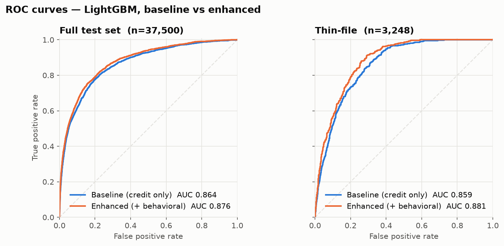
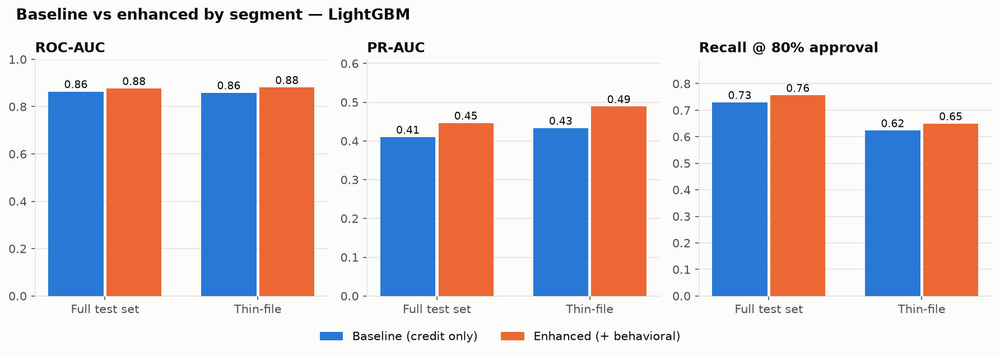
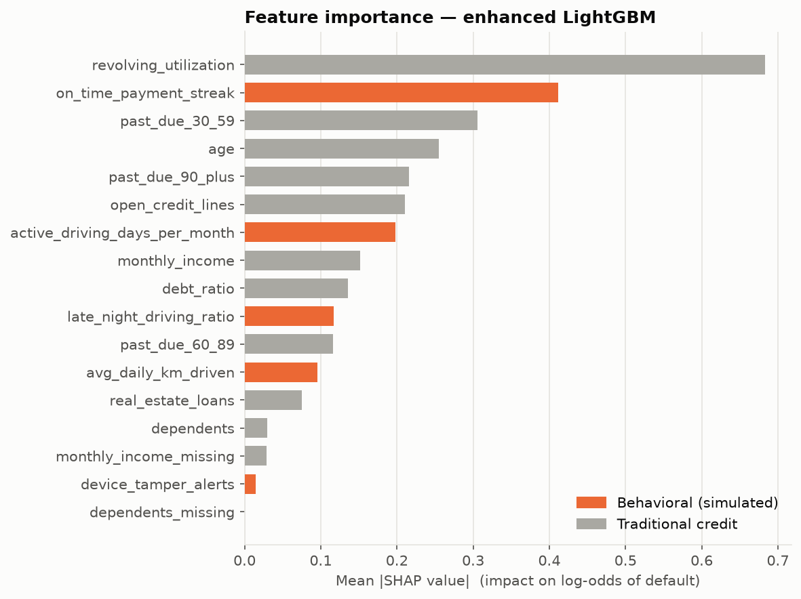
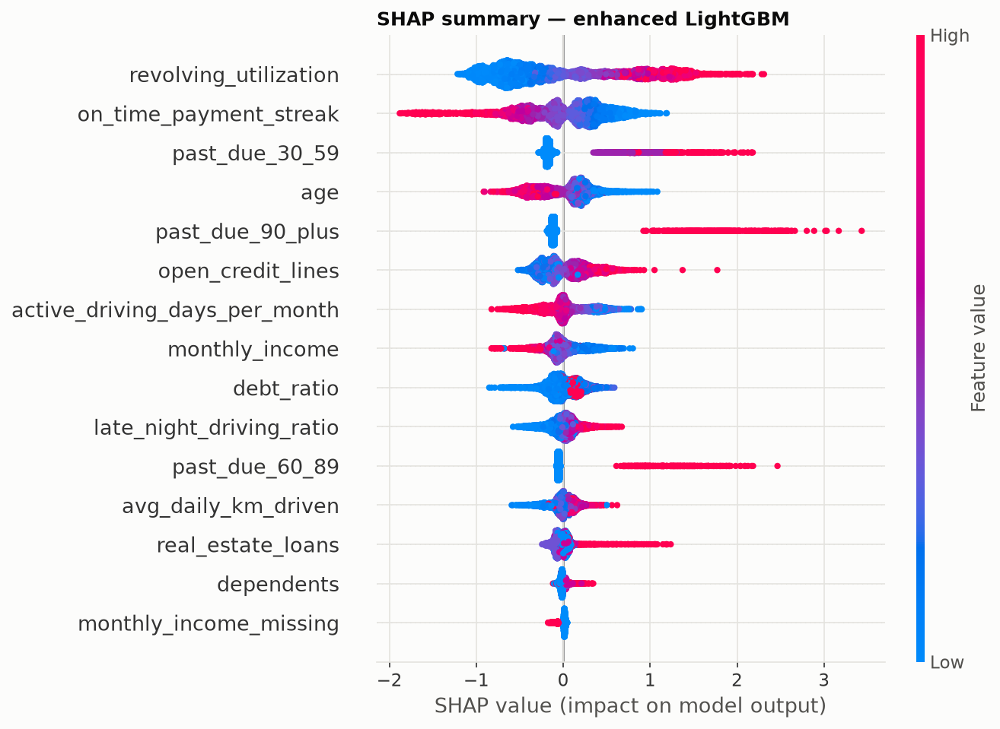

# thin-file-credit-scoring

**Can vehicle-usage data help lenders score people who have almost no credit history?**

This project builds a credit-scoring pipeline and a scoring API that combine
traditional bureau features with **behavioral / mobility features** of the kind
produced by an in-vehicle IoT device. It then measures how much those features
help, with a focus on **thin-file applicants**.

> ⚠️ **The behavioral features in this project are simulated.** No real telematics
> data is used. The simulated features are generated from the default label plus
> noise (see [`src/simulate.py`](src/simulate.py)), so the results show *how* such
> data would be integrated, evaluated and explained. They are **not** evidence of
> real-world performance.

---

## The problem: thin-file borrowers

Billions of adults have little or no formal credit history. Many of them are
gig workers, recent migrants, or young people. A bureau model has almost nothing
to go on for these applicants, so they are either rejected outright or priced as
if they were high risk. For vehicle loans, that shuts people out of the asset
they need to earn a living (ride-hailing, delivery, logistics).

Global Mobility Service (GMS) addresses this with the **MCCS** device installed
in financed vehicles:

1. **Security:** if payments are missed, the lender can remotely prevent the
   engine from starting. This lowers loss-given-default, so lenders can serve
   riskier segments.
2. **Data:** the device produces a continuous record of how the vehicle is used,
   which acts as an *alternative credit signal* for people whom the bureau
   cannot see.

This project explores the second point. If we add usage-based signals to a
traditional scorecard, how much better can we rank risk, especially for the
thin-file segment?

## Approach

```
cs-training.csv ──► clean ──► + simulated behavioral ──► stratified split ──► 4 models ──► evaluate ──► API
                  (src/data)      (src/simulate)            (train / calib / test)   (src/train)  (src/evaluate) (src/api)
```

| Step | What happens |
|---|---|
| **Data** | Kaggle *Give Me Some Credit* (150k borrowers, target `SeriousDlqin2yrs` → `serious_dlq_2yrs`). Drop the index column; drop rows with age < 18; map past-due sentinel codes (96/98) to a cap; cap extreme outliers at fixed domain limits. |
| **Missing values** | `MonthlyIncome` (~20% missing) and `NumberOfDependents` (~3%) are median-imputed with medians **learned on the training split only**, and each gets a `_missing` flag. The imputer is part of the saved pipeline, so the API accepts `null` income. |
| **Behavioral features** | Five simulated device features (below), seeded for reproducibility. |
| **Thin-file segment** | `open_credit_lines <= 2` (configurable via `THIN_FILE_MAX_OPEN_LINES`). |
| **Split** | Stratified on *target × thin-file*: 75% train (of which 20% is held out for probability calibration) / 25% test. |
| **Models** | **Baseline** (credit features only) vs **Enhanced** (credit + behavioral), each trained as **logistic regression** (readable baseline; log1p + standardised) and **LightGBM** (main model). |
| **Class imbalance** | ~6.7% default rate. Handled with `class_weight="balanced"` / `scale_pos_weight`, followed by **Platt calibration** on held-out data so the API's probability of default is a real probability. |
| **Evaluation** | ROC-AUC, PR-AUC, and **recall at an 80% approval rate** (approve the lowest-risk 80% and measure what share of defaulters was caught), for the full test set **and** the thin-file segment. Includes a paired-bootstrap 95% CI on the AUC lift. |
| **Explainability** | SHAP (TreeSHAP) for global importance and for the per-applicant "top 3 factors" in the API. |

### Simulated behavioral features

Every applicant gets a hidden "financial stress" latent:

`z = 0.8 · defaulted + 0.3 · credit_stress + N(0, 1)`

Each feature is a noisy, plausibly shaped function of `z`. Individually they
are weak (single-feature AUC ≈ 0.55–0.71 on the test set), and they are partly redundant with
bureau data through the `credit_stress` term.

| Feature | Meaning | Assumed relationship |
|---|---|---|
| `on_time_payment_streak` | consecutive months paid on time (0–36) | shorter under stress |
| `active_driving_days_per_month` | days the vehicle was used (0–30) | steady use ≈ steady income |
| `avg_daily_km_driven` | km/day on active days | weakest signal; heavy use slightly riskier |
| `late_night_driving_ratio` | share of km driven 00:00–05:00 | slightly higher under stress |
| `device_tamper_alerts` | tamper / disconnect events | rare; much more likely under stress |

Full assumptions are in the docstring of [`src/simulate.py`](src/simulate.py).

## Results

LightGBM and logistic regression, baseline → enhanced. Test set = 25% hold-out.
Generated by `make evaluate` (also saved to `reports/results.md` and `reports/metrics.csv`).

<!-- RESULTS:START -->
| Model | Segment | n | Default rate | ROC-AUC (base → enh) | PR-AUC (base → enh) | Recall @ 80% approval (base → enh) | ΔROC-AUC [95% CI] |
|---|---|---:|---:|---|---|---|---|
| LightGBM | Full test set | 37,500 | 6.7% | 0.864 → **0.876** | 0.410 → **0.446** | 72.9% → **75.6%** | +0.013 [+0.009, +0.016] |
| LightGBM | Thin-file | 3,248 | 12.9% | 0.859 → **0.881** | 0.433 → **0.489** | 62.3% → **64.9%** | +0.022 [+0.014, +0.030] |
| Logistic reg. | Full test set | 37,500 | 6.7% | 0.854 → **0.869** | 0.382 → **0.416** | 69.9% → **73.5%** | +0.015 [+0.011, +0.019] |
| Logistic reg. | Thin-file | 3,248 | 12.9% | 0.839 → **0.865** | 0.406 → **0.453** | 59.9% → **62.5%** | +0.026 [+0.018, +0.034] |
<!-- RESULTS:END -->

**Key findings** (for the seed and simulation settings in this repo):

- **Thin-file applicants are the hard, risky segment.** They make up 8.7% of
  applicants but default at **12.9%**, nearly twice the average of 6.7%. With
  credit data only, LightGBM ranks them slightly worse than everyone else
  (AUC 0.859 vs 0.864).
- **Behavioral data helps thin-file applicants roughly twice as much.** The ROC-AUC
  lift is **+0.022** on thin-file applicants vs +0.013 overall (LightGBM), and
  PR-AUC rises 0.43 → 0.49. The 95% bootstrap CIs exclude zero for both.
- **Fewer bad loans at the same approval rate.** Approving the
  best 80% of thin-file applicants, the enhanced model catches 64.9% of
  defaulters (vs 62.3%), and the default rate among approved thin-file
  applicants falls from 6.1% to 5.7% (`reports/metrics.csv`).
- **LightGBM beats the logistic baseline**, but only by about 0.01 AUC. The
  readable model is a credible fallback or challenger.
- **Keep the caveat in mind:** these gains exist because the simulation puts
  signal into the behavioral features. The contribution of this project is the
  pipeline, the thin-file evaluation design and the explainable API, not the
  size of the lift.

| ROC curves | Baseline vs enhanced by segment |
|---|---|
|  |  |

| Feature importance (mean \|SHAP\|) | SHAP summary |
|---|---|
|  |  |

## How to run

Requires Python 3.12 and [uv](https://docs.astral.sh/uv/) (or plain `pip`).
On macOS, LightGBM needs the OpenMP runtime: `brew install libomp`.

```bash
# 1. Get the data (Kaggle account required)
#    https://www.kaggle.com/c/GiveMeSomeCredit/data  ->  data/cs-training.csv

# 2. Set up, train, evaluate, test
make setup
make train       # -> models/*.joblib
make evaluate    # -> reports/metrics.csv, reports/results.md, reports/figures/*.png
make test

# 3. Serve the API
make serve       # http://localhost:8000/docs
```

Configuration (environment variables): `THIN_FILE_MAX_OPEN_LINES` (default 2),
`APPROVAL_RATE` (default 0.80), `DATA_PATH`, `MODELS_DIR`, `MODEL_PATH`.

## API

`GET /health`

```json
{"status": "ok", "model_loaded": true, "model": "enhanced_lgbm"}
```

`POST /score`: traditional and behavioral features. `monthly_income` and
`dependents` may be `null`. Unknown fields and out-of-range values return `422`.

```bash
curl -X POST localhost:8000/score -H "Content-Type: application/json" -d '{
  "revolving_utilization": 0.35,
  "age": 29,
  "past_due_30_59": 0,
  "debt_ratio": 0.4,
  "monthly_income": 3200,
  "open_credit_lines": 1,
  "past_due_90_plus": 0,
  "real_estate_loans": 0,
  "past_due_60_89": 0,
  "dependents": 1,
  "on_time_payment_streak": 18,
  "avg_daily_km_driven": 42.0,
  "active_driving_days_per_month": 26,
  "late_night_driving_ratio": 0.05,
  "device_tamper_alerts": 0
}'
```

Response from the model trained with `make train`. It's a 29-year-old thin-file
applicant with a clean record: approved at PD 2.6%.

```json
{
  "probability_of_default": 0.026,
  "credit_score": 713,
  "decision": "approve",
  "thin_file": true,
  "top_factors": [
    {"feature": "age", "description": "Age",
     "value": 29.0, "effect": "increases risk", "impact": 0.3394},
    {"feature": "monthly_income", "description": "Monthly income",
     "value": 3200.0, "effect": "increases risk", "impact": 0.3266},
    {"feature": "past_due_30_59", "description": "Times 30-59 days past due",
     "value": 0.0, "effect": "decreases risk", "impact": -0.1708}
  ],
  "model": "enhanced_lgbm"
}
```

- **`credit_score`**: 300–850 "points to double the odds" scaling. 660 corresponds to 15:1 good:bad odds (PD ≈ 6%), and every 40 points doubles the odds.
- **`decision`**: `approve` if PD < 8%, `reject` if PD > 25%, otherwise `review` (see `src/config.py`).
- **`top_factors`**: the three largest SHAP contributions to the applicant's log-odds of default.

## Project structure

```
src/
  config.py     paths, seed, thin-file threshold, policy knobs
  data.py       load + clean (sentinels, caps)
  features.py   train-fitted imputation, missing flags, thin-file mask
  simulate.py   SIMULATED behavioral features (documented assumptions)
  model.py      CreditScorer (pipeline + calibration + SHAP), score & decision
  train.py      baseline vs enhanced × logreg / LightGBM
  evaluate.py   metrics, bootstrap CI, charts
  api.py        FastAPI service
tests/          simulation reproducibility, feature pipeline, metrics, API
notebooks/      01_eda.ipynb
reports/        metrics + figures
data/           (gitignored) cs-training.csv
models/         (gitignored) trained artifacts
```

## Limitations

- **Synthetic behavioral data.** The lift depends directly on the simulation
  parameters (`SIGNAL`, `CREDIT_COUPLING`). Setting `SIGNAL=0` removes it
  entirely. The results show that the pipeline works, not that telematics
  predicts default.
- **Timing / availability.** A real applicant has no device history at the
  moment they apply. In practice, behavioral data would feed renewals,
  top-up loans, limit changes, or early-warning models after a trial period,
  rather than the very first decision.
- **Dataset fit.** *Give Me Some Credit* is US-style consumer bureau data, not
  vehicle-loan data from GMS's markets (Philippines, Indonesia, Japan, Cambodia).
  "Thin-file" is approximated by the number of open credit lines.
- **Small segment.** The thin-file test segment has only a few thousand rows, so
  its metrics are noisier; see the bootstrap CI column.
- **Decision thresholds** are illustrative. Real cut-offs come from the lender's
  risk appetite, pricing, and the loss reduction the ignition-control feature provides.
- **Explanations.** SHAP explains the model, not causality. Factor wording would
  need legal review before being shown as adverse-action reasons.

## Next steps

- **Real telematics data:** replace `simulate.py` with features engineered from
  device logs (trip regularity, idle time, route stability, geofence patterns),
  and evaluate on out-of-time splits.
- **Fairness checks:** compare approval rates, calibration, and error rates
  across age and region groups. Late-night driving, for example, may proxy for
  occupation or shift work and penalise protected groups.
- **Privacy:** data minimisation, consent, and aggregation of location data.
- **Monitoring:** population stability index (PSI) and feature drift once the
  device data changes (new vehicle types, markets).
- **Reject inference:** the training data only contains booked loans.
- **Model governance:** monotonic constraints in LightGBM (e.g. more tamper
  alerts must never lower risk), a model card, and a champion/challenger setup.
